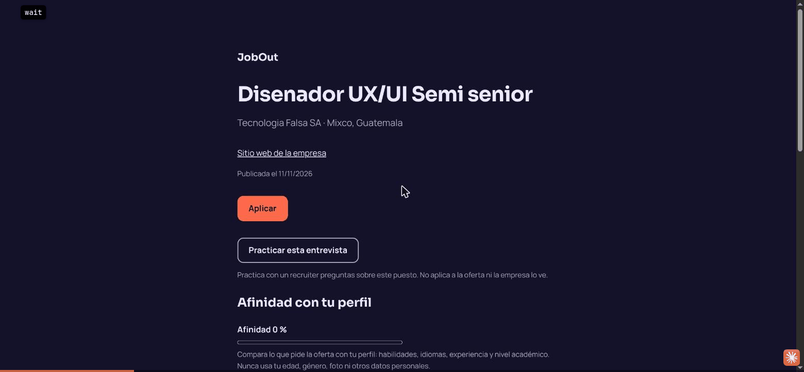
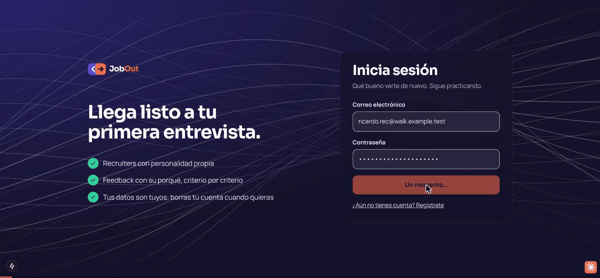
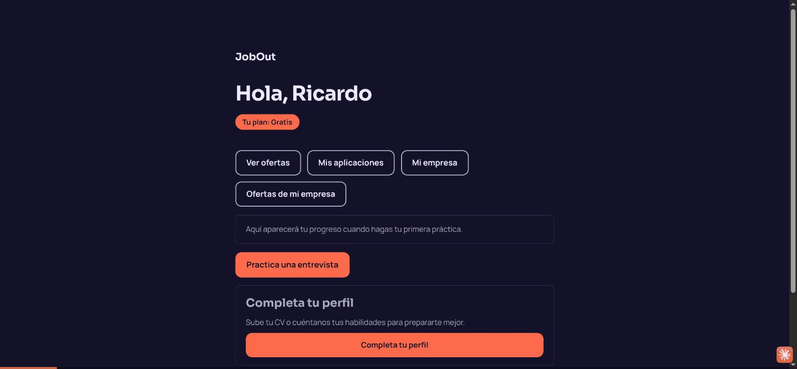
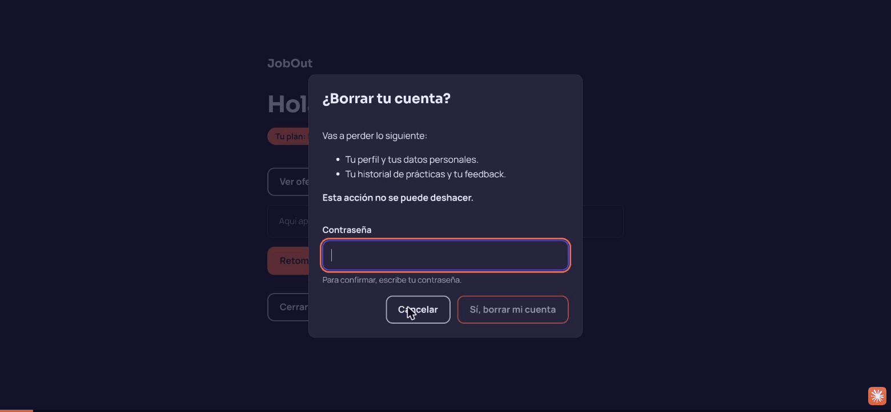

# jobout-web

La interfaz de **JobOut**. Next.js.

No persiste nada: pinta lo que devuelve `jobout-core-api` y conduce la entrevista contra
`jobout-interview`.

Documentación del proyecto: **[jobout-docs](https://github.com/eldmark/jobout-docs)**.
Reglas para agentes: [`AGENTS.md`](AGENTS.md).

## Demo

Recorridos grabados de la plataforma (datos inventados). También se ven en la app en
**`/demo`**, sin iniciar sesión (`http://localhost:3000/demo`). Los GIF viven en
[`public/demo/`](public/demo/).

**Candidata: oferta, práctica y retiro** — afinidad con su perfil, práctica de la entrevista de la oferta y retiro de una aplicación.



**Empresa: equipo, oferta y verificación** — invitaciones, requisitos de una oferta y verificación de la empresa por la plataforma.



**Empresa: panel de aplicantes** — solo lo que la persona consintió; favoritos y cambios de estado.



**Borrado de cuenta** — los datos personales se eliminan y lo que queda se anonimiza.



## Levantar

```bash
cp .env.example .env.local                        # completá los valores
cp docker-compose.example.yml docker-compose.yml
docker compose up
```

```
http://localhost:3000
http://localhost:3000/health
```

`docker-compose.yml` y los `.env` están en `.gitignore`: son tuyos. Lo que se versiona son los
`.example`.

**Backend y frontend juntos, con un comando:**

```bash
cd ../jobout-docs && make dev
```

Requiere que los tres repos estén clonados como hermanos:

```
jobout/
├── jobout-docs/
├── jobout-core-api/
└── jobout-web/          ← este
```

## Desarrollar

```bash
npm test           # vitest
npm run lint
npm run typecheck  # tsc --noEmit
npm run build
```

El contenedor de desarrollo monta el código del host, así que al guardar un archivo la página
se actualiza sola. `node_modules` y `.next` viven en volúmenes anónimos: el contenedor usa los
suyos y no los pisa lo que tengas en el host.

**Después de `git pull` con una dependencia nueva** (cambió `package.json` o `package-lock.json`),
el volumen anónimo de `node_modules` sigue siendo el viejo: la página falla con
`Module not found: Can't resolve '…'` (por ejemplo `three`, de la sala de entrevista). Es un error
de compilación del servidor de desarrollo, no del navegador, así que ningún respaldo de la interfaz
puede taparlo. Se arregla reconstruyendo la imagen y recreando el contenedor con su volumen:

```bash
docker compose build web && docker compose up -d --no-deps --force-recreate -V web
```

## Variables de entorno

Todo lo que lleve **`NEXT_PUBLIC_`** se compila dentro del bundle y **viaja al navegador**. Es
visible para cualquiera que abra las herramientas de desarrollo.

Un secreto nunca lleva ese prefijo. El CI rechaza cualquier `NEXT_PUBLIC_*SECRET`,
`*TOKEN`, `*PASSWORD` o `*_KEY`.

## Estructura

```
app/
  layout.tsx       raíz
  page.tsx         inicio
  globals.css      tokens de color, claro y oscuro
  health/route.ts  healthcheck de Docker
tests/             vitest
```
